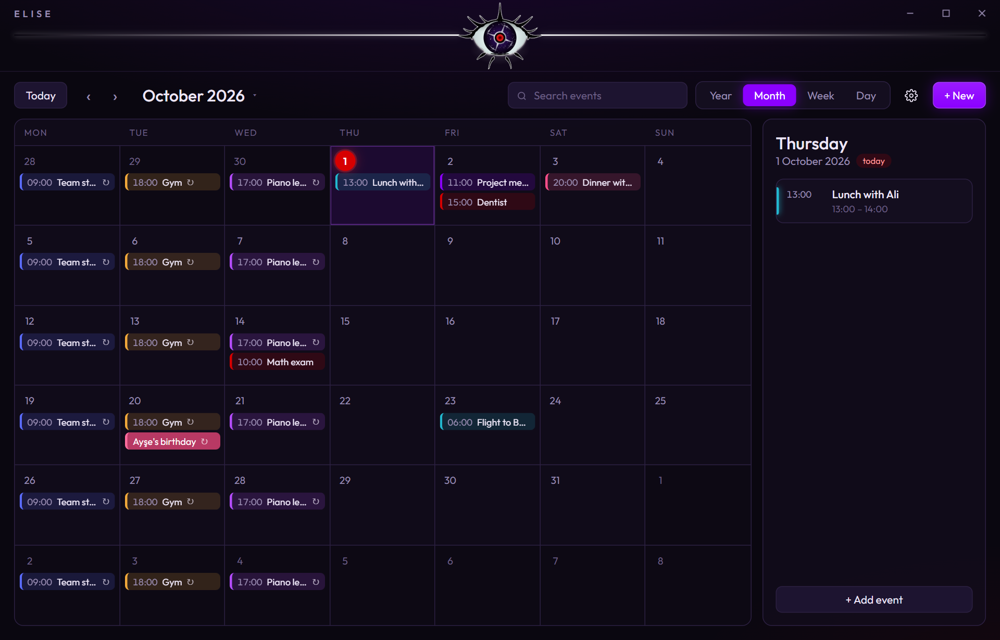
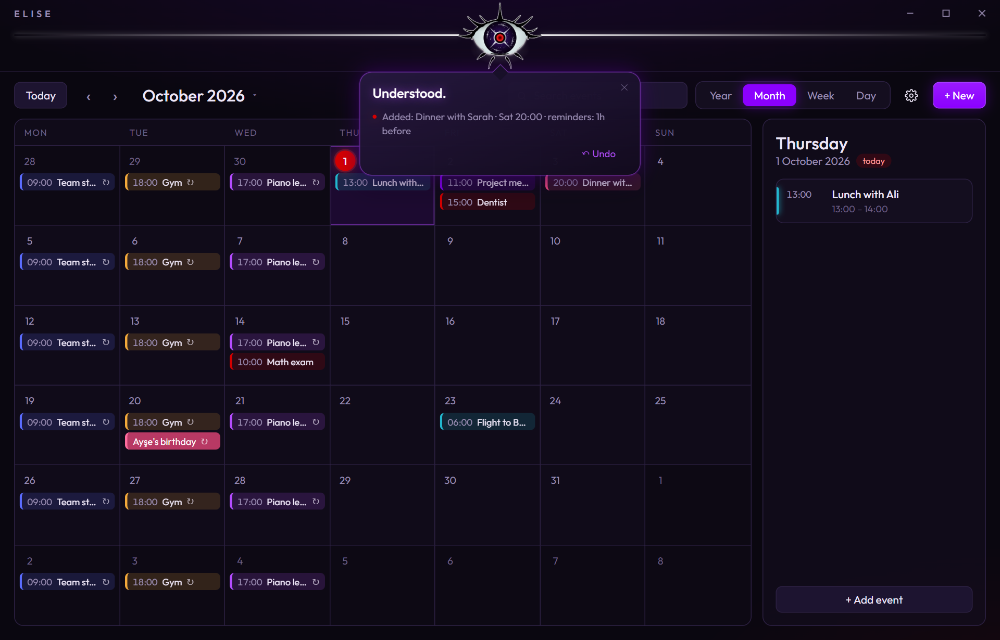
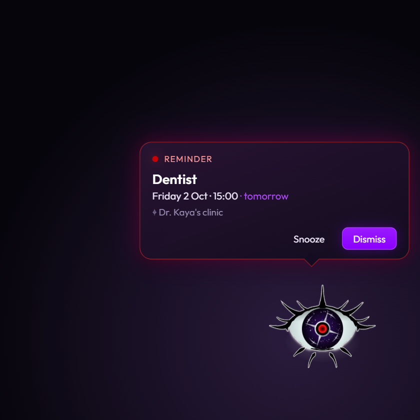
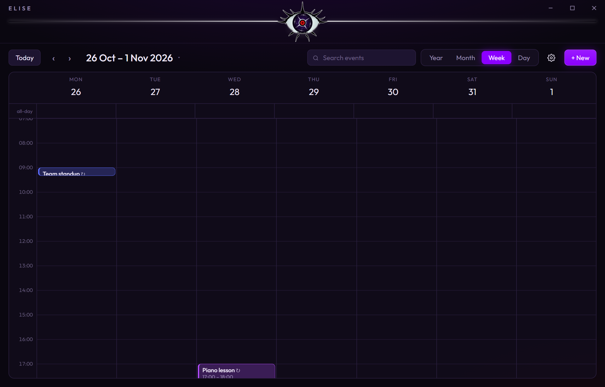
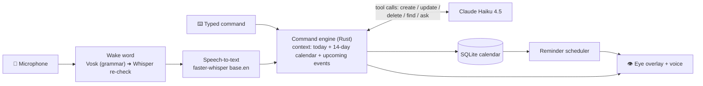

# Elise

**A voice-controlled calendar assistant for Windows. Say "Elise, add a dentist appointment on Friday at 3pm, remind me the day before", or type it in English or Turkish, and the event is created, moved or cancelled.**

<p align="center">
  
</p>

Elise lives in the Windows tray. Say her name or press <kbd>Ctrl</kbd>+<kbd>Alt</kbd>+<kbd>E</kbd> from anywhere, including over a game, and an eye opens in the corner of the screen to take your command.

## Features

- **Natural-language commands**: add, move, rename, cancel and ask about events ("push the project meeting an hour later", "what do I have tomorrow?", "yarınki toplantıyı iptal et").
- **Voice, fully offline**: the wake word ("Elise" / "Hey Elise") and speech-to-text run on your PC. No audio ever leaves the machine. Saying the command in one breath ("Elise, cancel lunch with Ali") skips the greeting.
- **Reminders that come to you**: the eye appears with the reminder and reads it out (offline neural voice), with snooze. Missed reminders show up when the PC wakes.
- **A real calendar UI**: year, month, week and day views, drag-and-drop, repeating events (with "this / following / all" edits), search, undo for every command.
- **Built for a gaming PC**: starts with Windows, ~0% CPU while idle, the eye works over borderless games, and a "big eye on screen" mode.

| Calendar | Typed command |
|---|---|
|  |  |
| **Reminder** | **Week view** |
|  |  |

<sub>Screenshots use made-up sample data, rendered from the real UI by `npm run screenshots`.</sub>

## How it works



The app is **Tauri 2** (a Rust backend with a React UI) rather than Electron, because it runs all day next to games and Tauri uses a fraction of the memory. Voice runs in a small **Python sidecar**: a cheap, always-on **Vosk** grammar listens for the name, and a hit is only accepted if **Whisper** hears "Elise" in the same audio. That two-stage check is what stops phrases like "hey, at least…" from waking her. Understanding is done by **Claude Haiku 4.5** with **tool calling**: the model never edits the database directly, it calls `create_event` / `update_event` / `delete_event` / `find_events` / `ask_clarification`, and the confirmation you see is generated from the *actual* changes, not from the model's own words, so it can't claim something it didn't do. Times are stored as local wall-clock time, so a 09:00 event stays at 09:00 across daylight-saving changes.

## Results

104 commands ([tests/commands.json](tests/commands.json)) are run through the same command engine the app uses, against a fixed seed calendar with "now" pinned to Thursday 2026-10-01 10:00. A command passes only if the calendar ends up **exactly** right: the right event, date, time, length, repeat rule and reminders, and nothing else touched. Questions must not change anything; unclear commands pass only if Elise asks back instead of guessing.

| Test set | Commands | Accuracy |
|---|---:|---:|
| **All** | 104 | **97%** |
| English | 58 | 97% |
| Turkish | 46 | 98% |
| Simple adds | 20 | 100% |
| Relative dates ("in 2 weeks", "öbür gün") | 22 | 95% |
| Moves & edits | 18 | 94% |
| Cancels | 11 | 91% |
| Reminders | 10 | 100% |
| Repeating events | 8 | 100% |
| Questions | 9 | 100% |
| Unclear (should ask back) | 6 | 100% |

Median response time: **2.1 s** (claude-haiku-4-5, temperature 0). Full report with every failure: [tests/results.md](tests/results.md).

**Before vs after.** The first run scored **90%** ([baseline](tests/results-baseline.md)). The fixes were general, not tuned to individual sentences: give the model a 14-day calendar with weekday names (it had listed Friday's events for "Tuesday"), stricter rules on when to act versus ask, and a few Turkish date words. Because the same set guided those fixes, treat 97% as optimistic for brand-new phrasings.

Run it yourself (uses your API key, costs well under $1): `npm run eval`.

## Tech stack

| Part | Choice |
|---|---|
| App shell | Tauri 2 (Rust) + WebView2 |
| UI | React 19, TypeScript, Vite, Motion; the eye and summoning circle are animated SVG |
| Language understanding | Claude Haiku 4.5 via the Messages API, tool calling (raw HTTP from Rust) |
| Storage | SQLite (rusqlite), local only; API key in Windows Credential Manager |
| Wake word | Vosk small English model in grammar mode, verified by Whisper |
| Speech-to-text | faster-whisper `base.en` (int8, CPU) |
| Voice | Kokoro TTS (`af_heart`), offline |

## Setup

Requirements: Windows 10/11, [Node.js](https://nodejs.org) 20+, [Rust](https://rustup.rs) (stable, MSVC), and Python 3.10+ for voice. You also need an [Anthropic API key](https://console.anthropic.com).

```powershell
git clone https://github.com/SedatAliMengi/elise.git
cd elise
npm install

# optional, for voice (one time, ~800 MB of models)
powershell -ExecutionPolicy Bypass -File voice\setup.ps1

# run in development
npm run tauri dev
```

Then open **Settings → Elise's mind**, paste your API key and press **Save**. It's stored in Windows Credential Manager, never in a file.

- **Install it properly** (tray, start with Windows): `npm run tauri build`, then run the installer from `src-tauri\target\release\bundle\nsis\`.
- **Tests**: `npm test` (offline unit tests: recurrence, reminders, undo, scoped edits, scheduler). For the accuracy test, `npm run eval` with `ANTHROPIC_API_KEY` set in the environment or in a `.env` file (see `.env.example`).

## Limitations and next steps

- **Over-cautious sometimes.** All three test failures are Elise asking a question when she could have acted (for example "Cancel tomorrow's meeting" when there's also a dentist appointment tomorrow). That's the safer way to be wrong, but it's still friction.
- **Voice is English-only.** Typed Turkish scores 98%, but the speech model is `base.en`. Next: switch to the multilingual Whisper model and add Turkish wake phrases.
- **The wake word was tested on synthetic clips**, not a broad set of real voices and rooms. Next: record real samples and tune the thresholds.
- **The accuracy test is single-turn.** It doesn't play through clarification follow-ups, and the set was also used to guide the prompt changes.
- **Windows-only**, and the overlay can't draw over exclusive-fullscreen games (borderless is fine).
- **Software rendering.** WebView2 runs with `--disable-gpu`, because FPS-overlay tools (RivaTuner/Afterburner, game overlays) inject into its GPU process and crash it. It costs about 1.7% CPU while the calendar window is open, and 0 when it's in the tray.
- **No sync.** It's one PC, by design for now. Next: optional CalDAV / Google Calendar sync and a phone companion.

## License

[MIT](LICENSE)
